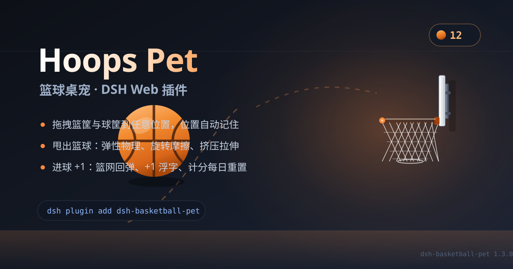

# 篮球桌宠 · Hoops Pet

给 **DSH Web UI** 的桌宠插件：一颗真正会弹的篮球停在你的工作区上，配一个能拖到任意位置的篮筐和一个装球的木箱，进球记 1 分，分数每天自动清零。



> English docs: [README.md](README.md)

---

## 为什么值得装

- **手感是真的物理**：重力、空气阻力、自旋、滚动摩擦、撞墙衰减，落地还有挤压回弹——不是一段循环动画。
- **完全不挡操作**：桌宠挂在点击穿透的浮层里，只有篮球、篮筐、木箱三样东西吃鼠标事件，其它点击照样落到下面的界面上。
- **小游戏循环**：把篮筐拖到顺手的位置，甩球进去，看着网兜下坠——每天重新开始。

## 功能一览

| | |
|---|---|
| 🏀 **弹跳篮球** | 重力 `2400 px/s²`、地面弹性 `0.78`，带空气阻力与自旋；砸地会压扁，高速下落会拉长。 |
| 🥅 **可拖动篮筐** | 玻璃篮板、钢制托架、四段渐变篮圈、菱形网兜，进球时整张网下坠回弹。篮圈 / 篮板 / 托架都能抓着拖。 |
| 📦 **可拖动木箱** | 球在箱子里待命；拖着箱子走，球会跟着走。 |
| 🖱️ **甩手投篮** | 用最近 110 ms 的指针位移换算初速度（上限 2600 px/s），可以平射、抛投、打板。 |
| 🎯 **进球计分** | 从篮圈内下落穿过即 +1：网兜回弹、`+1` 浮字、计分牌弹一下；打铁和打板都有真实反弹。 |
| 📅 **每日刷新** | 分数按自然日保存，跨天后自动归零（页面一直开着也会翻）。 |
| 💾 **位置记忆** | 篮筐和木箱的位置刷新后依然在。 |
| ♿ **尊重减弱动态** | 系统开启 `prefers-reduced-motion` 时不再自动蹦跶，但你的操作照常生效。 |
| 🔒 **不联网** | 纯渲染，除分数和两个位置外不存任何东西。 |

## 特效细节

- **挤压拉伸（squash & stretch）**：每次触地按冲击速度压扁，底部贴地不悬空；同时按竖直速度做轻微拉伸，球体始终以面积守恒的方式变形。
- **滚动与自旋耦合**：落地瞬间把旋转换算成水平速度，再把新的水平速度换算回旋转——球会「越滚越慢」而不是像滑块。
- **篮网 swish**：进球时网兜整体下坠 `14px` 再回弹，配合 `+1` 浮字上浮淡出。
- **计分牌 bump**：数字放大约 `12%` 再回位，颜色在橙色高亮间闪一下。
- **接球判定**：把球丢到木箱范围内会自动收进球筐，球心跟随箱子，不会出现球穿箱子。

## 安装

插件市场搜索「篮球桌宠 / Hoops Pet」，或命令行：

```bash
dsh plugin add dsh-basketball-pet
# 如果你的 dsh 要求显式指定 profile：
dsh plugin --profile desktop add dsh-basketball-pet
```

本地目录或 release 压缩包：

```bash
dsh plugin add ./dsh-basketball-pet-1.3.0.tgz
```

从 GitHub 源码：

```bash
dsh plugin add github:<owner>/dsh-basketball-pet
```

安装后刷新页面（`Ctrl+R`）即可。桌宠挂在 Web UI 的 `shell.overlay` 槽位。

## 操作

| 操作 | 效果 |
|---|---|
| 点木箱 | 球弹出来 |
| 按住球拖动后松手 | 按你的甩动方向飞出去 |
| 单击球（不拖） | 原地蹦一下 |
| 拖篮圈 / 篮板 / 托架 | 移动篮筐，计分牌跟随 |
| 拖木箱 | 移动箱子，里面的球跟着走 |
| 把球丢到木箱上 | 收进球筐 |
| 球穿过篮圈 | **+1** |

## 实现

单文件客户端插件（`client.js`），无构建、无运行时依赖：在 `shell.overlay` 上注册一个组件，自带 `requestAnimationFrame` 循环直接写 `transform`，React 不会逐帧重渲染。

- 物理常量：`GRAVITY 2400`、`FLOOR_REST 0.78`、`WALL_REST 0.84`、篮圈 `1.72`、篮板 `0.62`、空气阻力 `0.1`
- 碰撞：地面、左右墙、天花板、篮圈两端（小圆）、篮板前沿
- 进球判定：向下穿过篮圈平面、速度向下、且落在篮圈内圈窗口内
- 存储：`dsh-basketball-pet:score:v1`、`dsh-basketball-pet:layout:v1`（localStorage）

## 兼容性

- 需要带 `shell.overlay` 槽位与 `@deepseek-ai/dsh-client-ui-slots` 服务的 DSH Web UI
- Chromium / Electron / WebKit 内核的 DSH 桌面端均可，不依赖 Node

## 许可

MIT
